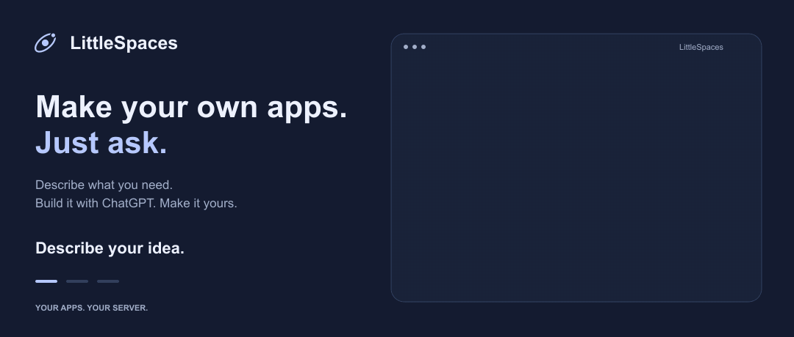

# LittleSpaces

**Make your own apps. Just ask.**

Describe what you need. Build it with ChatGPT. Make it yours.

A plant journal, a reading tracker, that oddly specific tool you've always wanted. Create personal apps through conversation, use them from your own launcher, and keep changing them as your needs change. Runs on your own server, with one private workspace per owner.

## Get started

**[Copy the setup prompt into Codex →](docs/get-started.md)** It will install LittleSpaces on your computer or VPS and guide you through setup.

You'll need an eligible ChatGPT account with subscription usage or available credits to build apps and use AI chat. LittleSpaces connects through ChatGPT sign-in; separate API keys aren't currently supported.

## Docs

- [Self-hosting and VPS deployment](docs/self-hosting.md) — including remote ChatGPT setup.
- [Project reference](docs/project-reference.md) — features, limitations, customization, and development.
- [App backend API](docs/applet-backends.md) · [Diagnostics](docs/diagnostics.md)
